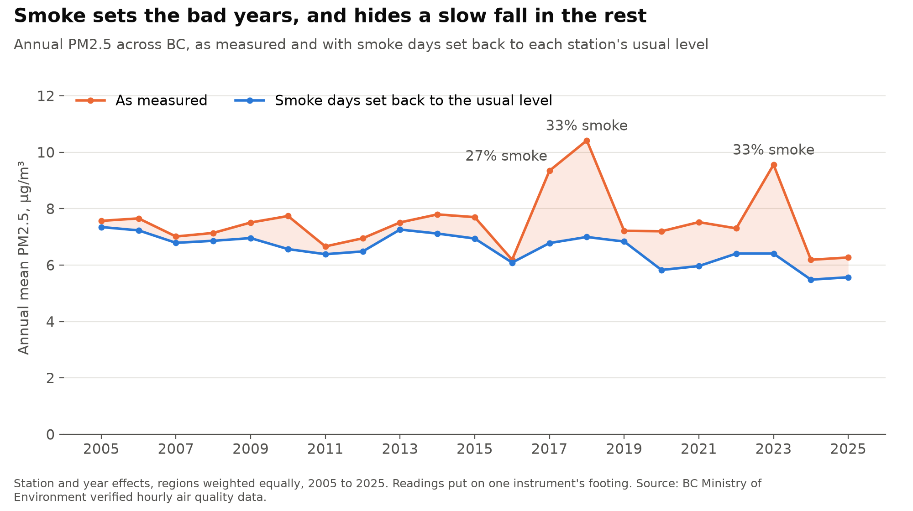
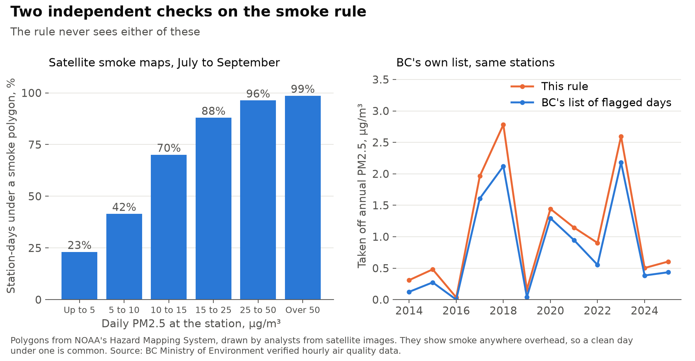
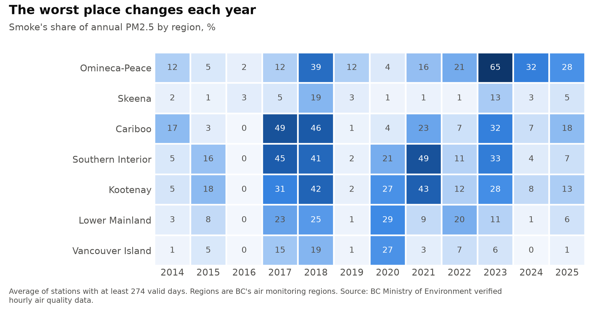
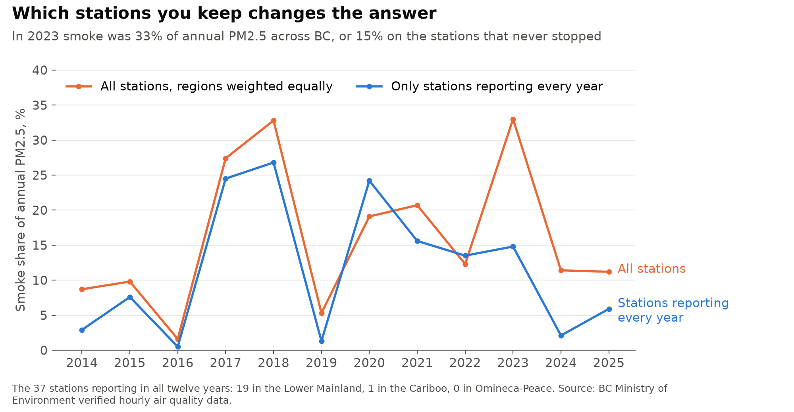
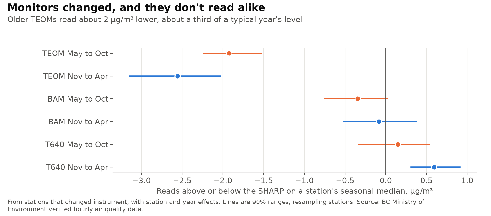
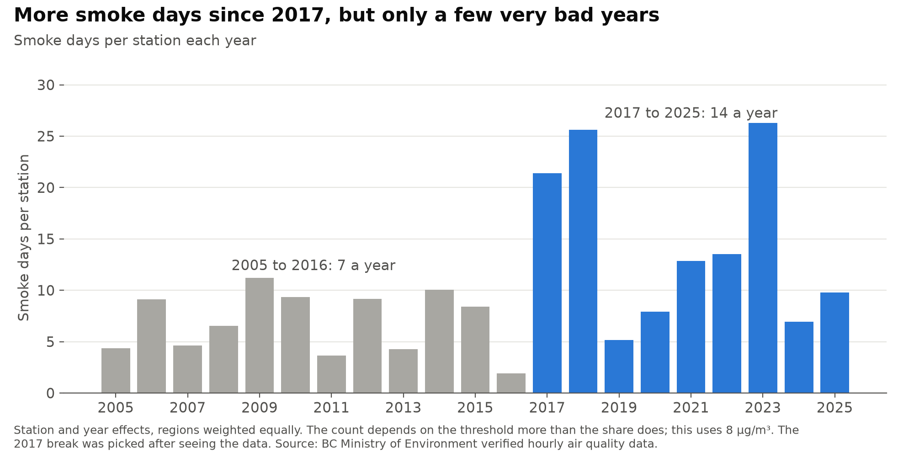
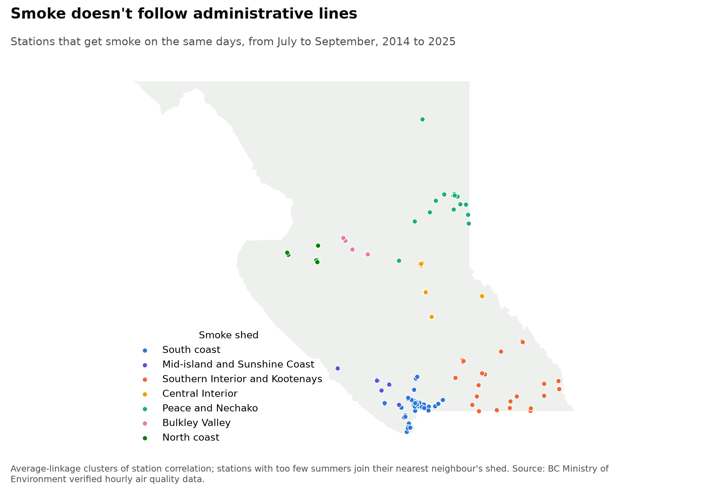
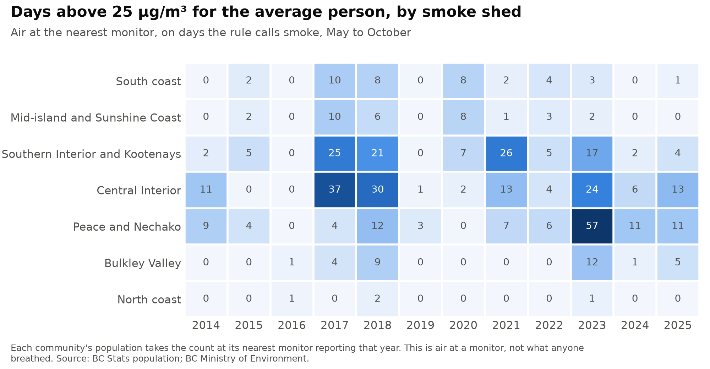
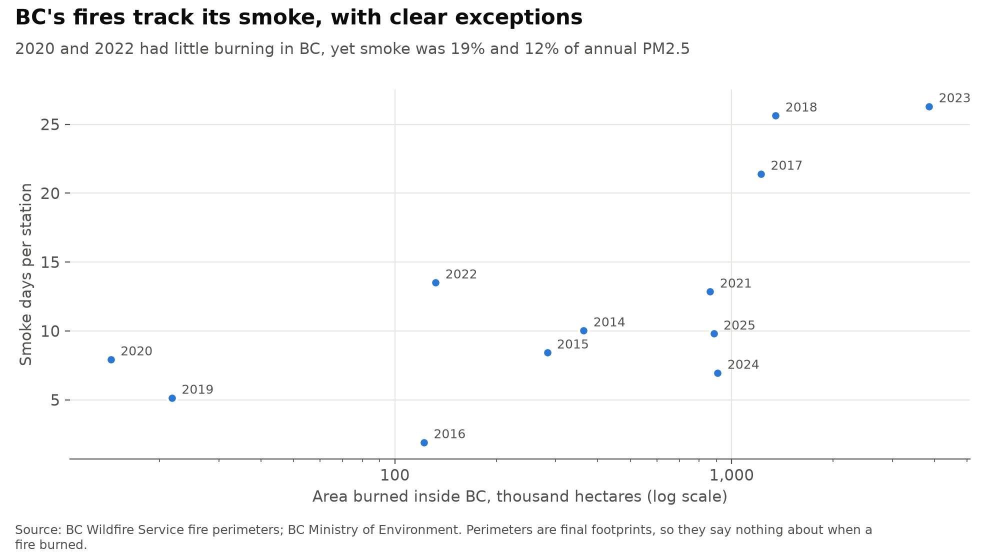
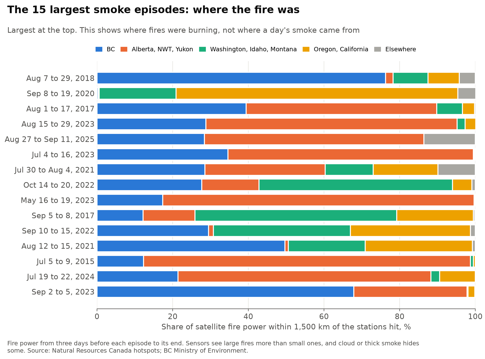

# bc_wildfire_smoke

[](https://github.com/atamalfuzi/bc_wildfire_smoke/actions/workflows/tests.yml)

How much of British Columbia's fine-particle pollution (PM2.5) is wildfire smoke? BC's monitors can't say what they are measuring, so this project separates smoke from everything else in 21 years of verified readings, with a simple rule checked against BC's own list and against satellite smoke maps. Python, with pandas, SciPy and scikit-learn.

**[Write-up with interactive charts](https://atamalfuzi.github.io/bc-wildfire-smoke.html).** Results are as of November 2026, with verified data through 2025.

**[Seasonal dashboard](https://atamalfuzi.github.io/bc_wildfire_smoke/)**, rebuilt daily from May to October from BC's unverified hourly file: this season's smoke days against 2014 to 2025, by region, and every station by day. BC corrects its data once a year, so those readings can change.

> **Personal project.** This is my own analysis of publicly available data. It is not associated with my work for any current or past employer and does not represent their views. It measures air at monitors and makes no claims about health.

| Question | Methods | Answer |
|---|---|---|
| [How much of BC's PM2.5 is smoke?](#1-how-much-of-bcs-pm25-is-smoke) | Rule-based detector, independent checks, station and year effects | About a third in 2018 and 2023 (30% to 35%), and 2% to 27% in other years since 2014. Smoke explains 74% of the year-to-year swings. |
| [Is the rest getting cleaner, and smoke getting worse?](#2-is-the-rest-getting-cleaner-and-smoke-getting-worse) | Theil-Sen trends, Kendall tests, exact permutation test | The rest is falling about 0.07 µg/m³ a year (0.03 to 0.10). Smoke has grown, but three years drive that. |
| [Which places get smoke together, and who lives there?](#3-which-places-get-smoke-together-and-who-lives-there) | Hierarchical clustering, resampled seasons, population at the nearest monitor | Seven smoke sheds that cross regional lines. The average person's days above 25 µg/m³ ran from under 1 to 12 a year. |
| [How much arrives from outside BC?](#4-how-much-arrives-from-outside-bc) | Case studies of the 15 largest episodes | Sometimes nearly all of it: in September 2020, 99% of the nearby fire power was outside BC. No percentage for each year is possible from this data. |

## What it shows



### 1. How much of BC's PM2.5 is smoke?

From May to October, a station-day counts as smoke if it is at least 8 µg/m³ above that station's usual level for the time of year, and at least half of the reporting stations within 200 km are also up by 4 or more. A road, a mill or a stove rarely lifts a whole region at once; smoke does. Each smoke day is then set back to the usual level.

Smoke was 33% of annual PM2.5 in 2018 and in 2023, and 27% in 2017. Across thresholds of 5 to 12 µg/m³ those shares move only from 35% to 30%. The standard deviation of annual PM2.5 falls from 1.07 to 0.55 µg/m³ once smoke is removed.



| Check | Result |
|---|---|
| Days on BC's list that the rule also flags | 97% of 3,605 |
| Yearly amount removed, against BC's figures | Correlation 0.99; the rule removes somewhat more, because BC's list holds almost only days above 25 µg/m³ |
| Under a satellite smoke polygon, July to September | 93% of the rule's days, 33% of other days (1,064 days) |
| Under a medium or heavy polygon | 77% against 10% |
| PM2.5 as a share of PM10 | 0.77 on the rule's days, 0.45 on others (32 stations, 3 years) |
| Carbon monoxide | 0.33 ppm against 0.16 ppm (19 stations, 3 years) |



**Two traps.** Keeping only stations that report every year gives 37 stations, 19 of them in the Lower Mainland and none in Omineca-Peace, and cuts 2023's smoke share from 33% to 15%. So the main results use station and year effects with each region counted equally.



Instruments changed too. From stations that switched, the older TEOM reads about 2 µg/m³ below the SHARP that replaced it, and the T640 rolled out by 2025 reads slightly above it. All readings are put on the SHARP's footing first.



### 2. Is the rest getting cleaner, and smoke getting worse?

As measured, annual PM2.5 has no trend since 2005 (−0.01 µg/m³ a year, 95% range −0.06 to +0.06). With smoke removed it falls 0.07 a year (0.03 to 0.10), and 0.11 a year since 2014 (0.05 to 0.19), when the instrument correction matters least.



Smoke's share of annual PM2.5 rose 0.6 points a year since 2005 (0.2 to 1.3), and smoke days averaged 14 a year from 2017 on against 7 before. An exact permutation test gives p = 0.005 for that gap, but 2017 was picked after seeing the data, so that is generous. Leave out the three worst years and the trend in smoke days is +0.15 a year (−0.13 to +0.46). Twenty-one seasons with three extreme ones can't separate a lasting shift from a run of bad years.

### 3. Which places get smoke together, and who lives there?



Clustering stations on how their summer readings move together gives seven groups, stable when seasons are resampled (adjusted Rand index 0.93 against the full data), which overlap only partly with BC's monitoring regions (0.61). Greater Victoria and the south island go with Vancouver and the Fraser Valley, not with Nanaimo or Courtenay. Prince George goes with Quesnel, not the Peace.



Weighting by where people live changes which years stand out. The average British Columbian's nearest monitor had 12 smoke days above 25 µg/m³ in 2017 and 11 in 2018, but 7 in 2023, when the smoke sat over the Peace and the north, where few people live. This counts air at a monitor, not what anyone breathed.

### 4. How much arrives from outside BC?



Area burned in BC and smoke days rank closely together (0.72), with exceptions. In 2020 about 14,000 hectares burned in BC, the smallest of these twelve years, yet smoke was 19% of annual PM2.5. In 2022, 132,000 hectares burned, and BC's list names the NW Pasayten Complex in Washington for 165 of its 296 flagged station-days.



Of the 15 largest episodes, 4 had most of the fire power within reach in the US, including September 2020, the second largest of all. BC led in 3, including August 2018, the largest. In the other 8, most was in Alberta, the Northwest Territories or spread across several places, which doesn't settle whether that smoke reached BC. Bars show where fires burned, not where a day's smoke came from. Splitting smoke by source properly needs transport modelling.

## Tried and dropped

`dropped.py` keeps these so the numbers can be checked. Each held out one season at a time, 2014 to 2025.

| Next-day PM2.5, May to October | Average error, µg/m³ | Days above 25 caught | False alarms | First days of high readings caught | 90% range covers days above 25 |
|---|---:|---:|---:|---:|---:|
| Tomorrow equals today | 3.20 | 65% | 35% | 0% | |
| Gradient boosting on the monitor network | 3.00 | 46% | 26% | 8% | 44% |
| Fire power by distance alone | 4.09 | 16% | 51% | 10% | 24% |
| Network and fire power | 2.98 | 48% | 24% | 10% | 47% |

The forecast cuts error 6% and misses most first days, the ones a forecast is for. Smoke arrives on the wind, and existing smoke forecast models already use it.

A regression of each region's smoke on fire power by province failed on held-out seasons (median R² −0.05).

Measuring whether people avoid smoke using Mobi bike-share trips, the one economic question here, is left out: its licence limits publishing the data and says that accessing it accepts its terms, so it isn't open data in the sense this project uses.

## Method

**Daily panel.** Hourly readings become daily means, keeping days with at least 18 hours. Moved stations are joined using BC's station merge table. A station-year counts with at least 274 days.

**Instruments.** Annual medians by season, regressed on station, year and instrument, using stations that changed instrument; a median is little moved by smoke. Ranges are 90%, resampling stations. Each reading then has its instrument's offset taken off.

**Usual level.** Each station's median for the day of the year, ±15 days, over all its years.

**Province-wide numbers.** Station and year effects, with weights so each of BC's seven monitoring regions counts equally. A plain average moves as monitors open and close.

**Smoke sheds.** Average-linkage clusters on rank correlation of log summer excess, 2014 to 2025, for the 62 stations with at least 500 summer days. The number of clusters is the one that changes least when seasons are resampled, and a cluster under three stations joins the one it correlates with best. Other stations join their nearest neighbour's shed.

**People.** BC Stats population by municipality, with each regional district's unincorporated population placed at the area-weighted centre of its other census subdivisions. Each takes the count at its nearest monitor with at least 138 days from May to October that year; 96% to 99% of people live within 100 km of one.

**Episodes.** Runs of days when at least 15% of reporting stations are flagged, joining gaps up to two days, ranked by total excess. Fire power is counted within 1,500 km of the stations hit, from three days before to the end.

## Limits

- The rule uses PM2.5 alone. Spring and fall open burning, dust and regional pollution can pass as smoke, and light smoke can be missed. There is no ground truth for lighter days: 14% of May to October days at 10 to 15 µg/m³ get flagged, with little to confirm them.
- Satellite polygons show smoke anywhere overhead. About 51% of station-days under one had less than 2 µg/m³ of excess at the ground, so they are strong evidence that a flagged day is real and weak evidence that an unflagged day is clean.
- Counts of smoke days depend on the threshold: 5,517 flagged station-days at 12 µg/m³ since 2014, 8,278 at 8 and 13,203 at 5. Shares are far steadier, so they are the headline.
- Usual levels come from the same readings they are tested against. A median resists smoke, but long smoke seasons can still raise it a little.
- Instrument gaps are estimated on seasonal medians and applied as flat offsets. How instruments compare in heavy smoke isn't tested, and the T640 has only one or two years behind it at most stations.
- The north has few monitors, and one station can stand for a very large area. Weighting regions equally is a choice, and weighting by population tells a different story.
- BC's list of flagged days exists to adjust air-management reporting, so it is not a complete count of smoke days. 99.9% of its days are above 25 µg/m³.
- Fire perimeters are final footprints with one date. Satellites miss fires under cloud or thick smoke, and their sensors changed over the years, so fire power isn't comparable across years without care.
- Polygons cover July to September only, for 1,064 of the 1,104 days from 2014 to 2025: the server drops quick requests.
- Nothing here estimates illness, deaths or costs, or says what any level means for a person's health.

## Data

| Data | Source | Licence |
|---|---|---|
| Verified hourly air quality, 2005 to 2025; list of flagged days; annual results; station list and history | [BC Ministry of Environment](https://catalogue.data.gov.bc.ca/dataset/77eeadf4-0c19-48bf-a47a-fa9eef01f409) | Open Government Licence - BC |
| Unverified year-to-date hourly data, for the dashboard | [BC Ministry of Environment](https://catalogue.data.gov.bc.ca/dataset/01867404-ba2a-470e-94b7-0604607cfa30) | Open Government Licence - BC |
| Fire perimeters and incident locations | BC Wildfire Service: [perimeters](https://catalogue.data.gov.bc.ca/dataset/22c7cb44-1463-48f7-8e47-88857f207702), [incidents](https://catalogue.data.gov.bc.ca/dataset/bc-wildfire-fire-incident-locations-historical) | Open Government Licence - BC |
| Population | [BC Stats](https://catalogue.data.gov.bc.ca/dataset/bc-sub-provincial-population-estimates-and-projections) | Open Government Licence - BC |
| Census subdivision boundaries | [BC Data Catalogue](https://catalogue.data.gov.bc.ca/dataset/current-census-subdivision-boundaries) | Statistics Canada Open Licence |
| Satellite hotspots | [Natural Resources Canada, Canadian Wildland Fire Information System](https://cwfis.cfs.nrcan.gc.ca/downloads/hotspots/archive/) | Open Government Licence - Canada, as on its open.canada.ca records |
| Smoke polygons | [NOAA Hazard Mapping System](https://www.ospo.noaa.gov/products/land/hms.html) | US government work; no licence page found |

Contains information licensed under the Open Government Licence - British Columbia and the Open Government Licence - Canada. Adapted from Statistics Canada; this does not constitute an endorsement by Statistics Canada of this product.

## Run it

Python 3.12:

```
python -m venv .venv
.venv\Scripts\activate          # Windows; on macOS or Linux: source .venv/bin/activate
pip install -r requirements.txt
python data.py
python smoke.py
python questions.py
python dropped.py
python figures.py
python site_data.py
```

Run them from the repository folder, in this order. `data.py` passes about 3 GB through but keeps only daily summaries in `data/`, about 100 MB, and later runs reuse them. The NOAA polygons at its end take about an hour. The rest takes about 10 minutes. Verified data are published once a year, usually by August: delete `data/` and raise `LAST_YEAR` in `data.py` to add a year.

To build the dashboard, run `python dashboard.py`. It needs no downloads beyond BC's current file, because the usual levels and season history are in `output/`. It writes a static site to `site/` and stops without writing if the file is stale, thin or full of implausible values. The [dashboard workflow](.github/workflows/dashboard.yml) does the same on GitHub Actions every day from May to October and publishes to GitHub Pages only if every step passes.

To run the tests: `pip install -r requirements-dev.txt`, then `pytest`. They use made-up data and need no downloads.

## License

Code: [MIT](LICENSE).
